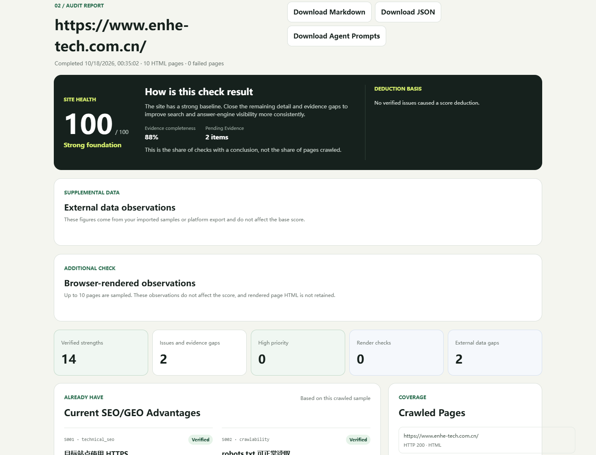

# SearchScope | Independent-Site SEO/GEO Auditor

> Helps independent website owners and AI creators review public-site SEO and GEO basics, then turn evidence into a practical improvement list.

A website opening in a browser does not mean search engines and AI tools can read it correctly. SearchScope checks public-page evidence and separates confirmed findings from items that need more information. It is read-only: it will not change your website, and it does not promise rankings or AI citations.

[简体中文](README.md) | [English](README.en.md)

 

    

> This cover is an illustration, not a screenshot of a real audit. Scores, trends, and figures in the image are visual examples, not results from a real website.

## Contents

- [1. What is SearchScope?](#what-is-searchscope)
- [2. See the output](#see-results)
- [3. Who is it for?](#who-is-it-for)
- [4. What do you get?](#deliverables)
- [5. What problems does it help with?](#problems-solved)
- [6. Installation and quick start](#install-and-start)
- [7. How to use it](#how-to-use)
- [8. How it works](#workflow)
- [9. Project files](#project-structure)
- [10. Notes and FAQ](#notes-and-faq)
- [11. Version](#version)
- [12. Related projects](#related-projects)
- [13. About the author](#author)
- [14. Keep exploring](#explore)

## 1. What is SearchScope?

SearchScope is a read-only auditor for public independent websites. It comes in three forms:

- **AI Skill:** A Skill is a set of instructions that helps an AI tool follow a particular process. It must be used with an AI tool that can load Skills. SearchScope's stable Skill identifier is **independent-site-seo-geo-auditor**.
- **Local web app:** A bilingual page that runs on your own computer. Enter a website and view the report in a browser.
- **Command-line tool:** For people who are comfortable using a terminal or want to add an audit to their own workflow.

SEO means search engine optimization. GEO here means making website content easier for AI answer tools to find, understand, and cite. SearchScope checks public-page signals such as crawl rules, page titles and descriptions, heading structure, language-page relationships, structured data, and AI crawler access.

You usually only need to provide the website homepage. Information such as site type, target language, priority pages, and page limit helps the AI explain findings in context. SearchScope reads public pages and organizes evidence, issue priority, suggested fixes, and ways to check them. It does not log in, submit forms, or change the website.

## 2. See the output

On 2026-10-18, SearchScope's local web app ran a read-only audit of [ENHE AI's website](https://www.enhe-tech.com.cn/): 10 HTML pages were read with 0 fetch failures. The screenshot shows a score of 100/100 and 88% evidence completeness for that run. Real-world page experience metrics and brand mentions or citations in answer engines still require external data. This result reflects only the sampled pages and does not promise rankings, traffic, or AI citations.

You can also review the [report template](assets/audit-report-template.md) to see how a complete report records scope, evidence, issue levels, and acceptance checks.

## 3. Who is it for?

### A good fit

- Owners of brand, content, ecommerce, or SaaS websites who want to review basic SEO signals on public pages.
- AI creators and small teams who want a repeatable, evidence-backed website review.
- People managing multilingual sites who need to check how language versions relate to each other.
- People using an AI tool that supports Skills and want the AI to follow consistent evidence rules.

### Not a fit right now

- Anyone expecting automatic website edits, continuous rank tracking, or guaranteed traffic, rankings, or AI citations.
- Anyone trying to audit an intranet, a local test site, or a page that requires login. By default, the tool accepts only public HTTP or HTTPS pages.
- Anyone expecting accurate traffic, ranking, or citation-rate data without Search Console, analytics, or real answer-engine samples. SearchScope does not guess these figures.
- Anyone who wants to run the Skill, web app, or command-line tool locally but does not have Python 3.10 or later. Availability of the no-install online entry point depends on that page's current status.

## 4. What do you get?

The result depends on how you use SearchScope:

- **Findings and evidence:** Existing strengths, detected issues, issue levels, page evidence, suggested fixes, and ways to verify them.
- **Score and scope:** The Skill and reports include a 100-point assessment based on verified issues, along with page coverage and evidence scope. Items that need browser rendering or external data are labeled separately and are not treated as confirmed issues.
- **Local web app:** View results in the browser and download a Markdown report, JSON data, or agent prompts. Downloads go to the folder configured by your browser.
- **Command-line tool:** Write JSON, Markdown, and a standalone HTML report to paths you choose. The HTML file can be opened directly in a browser without starting a server.
- **AI Skill:** Get analysis and follow-up suggestions in a compatible AI tool. Whether it can also create files depends on the tool and your request.

These results are not predictions of search rankings, traffic, or AI citations.

## 5. What problems does it help with?

A manual audit can mean checking pages one by one, and it is easy to mistake “not checked yet” for “definitely broken.” SearchScope organizes findings around page evidence and labels items that need browser review, external data, or further investigation.

This helps you start with issues that have clear evidence and higher priority. You or your developer still decide whether to make changes. Run another audit after a fix if you want to check what changed on public pages.

## 6. Installation and quick start

### What you need

| How you use it | Requirements |
|---|---|
| Online entry point | A web browser, internet access, and a public website URL. The online service is deployed separately from this repository. Its current availability, accounts, fees, and data handling are described by that service, not by this repository. |
| Local web app or command line | Python 3.10 or later and internet access to the public site. The default audit uses Python's standard library; no extra runtime package is needed. |
| AI Skill | An AI tool that can load Skills. For Codex, follow the installation steps below. The environment that runs the audit script also needs Python 3.10 or later. |
| Optional browser review | Only needed to inspect page information added by JavaScript. It requires Playwright 1.59.0 or later and Chromium. |

Node.js is not needed for normal use. You do not need to provide website passwords or webmaster-account credentials. Any charges for an AI tool or independently hosted service are set by that provider; this repository does not promise that those services are free.

### Easiest first try: the online entry point

The repository records this separate online entry point: [Open SearchScope online](https://enheai-seo-geo.coze.site/).

This route does not require installing the project on your computer. Account, fee, and data-handling terms still depend on the online service current page.

If the page is available, enter a public website URL and follow its current instructions. The service is maintained outside this repository, so its features, account requirements, fees, data handling, and availability may differ from the local version. Read the page's current terms first. If it does not open, or you want to control the environment yourself, use the local web app below.

### Run the web app on your computer

On the GitHub project page, click Code → Download ZIP and extract it. Or open a terminal in the folder where you want to keep the project and run the commands below. They download the full project. Do not copy only SKILL.md; the audit scripts and rule files are also needed.

**Windows PowerShell** (install Python 3.10 or later and Git first):

~~~powershell
git clone https://github.com/yangjing6213-dev/seo-geo-smart-audit-skill.git
cd seo-geo-smart-audit-skill
python app.py
~~~

**macOS or Linux terminal:**

~~~bash
git clone https://github.com/yangjing6213-dev/seo-geo-smart-audit-skill.git
cd seo-geo-smart-audit-skill
python3 app.py
~~~

When the terminal says the service has started, open this address in a browser on the same computer:

[http://127.0.0.1:8000](http://127.0.0.1:8000)

Enter a public website URL. For a first try, choose a quick audit of 10 pages and start the check. Results appear on the page. Use “Download Markdown” or “Download JSON” to save a report to your browser's download location. The web app listens only on your computer; it is not automatically open to your local network or the internet. Press Ctrl+C in the terminal to stop it.

If you use the ZIP download, extract the full archive first. Then open a terminal in the extracted project folder and run the command.

### Install the Codex Skill

To call the Skill in Codex, place the full repository in Codex's Skills folder. Run these commands only for a first-time install; do not clone again if the destination folder already exists.

**Windows PowerShell:**

~~~powershell
New-Item -ItemType Directory -Force "$env:USERPROFILE.codexskills" | Out-Null
git clone https://github.com/yangjing6213-dev/seo-geo-smart-audit-skill.git "$env:USERPROFILE.codexskillsindependent-site-seo-geo-auditor"
~~~

**macOS or Linux:**

~~~bash
mkdir -p ~/.codex/skills
git clone https://github.com/yangjing6213-dev/seo-geo-smart-audit-skill.git ~/.codex/skills/independent-site-seo-geo-auditor
~~~

Reload Skills or restart Codex after installation. Other AI tools may use different Skill folders and setup steps; follow their own instructions. If you do not have Git, download the ZIP from GitHub and extract the entire project into the appropriate Skill folder.

### Optional: review JavaScript-loaded page content

The default audit reads public-page content without running the page's JavaScript. If a page adds titles, descriptions, or structured data through JavaScript, install the optional browser components from the project folder:

~~~bash
python -m pip install -r requirements-renderer.txt
python -m playwright install chromium
~~~

On macOS or Linux, replace python with python3 if that is your Python command. Browser review is off by default and covers at most 10 pages. It does not measure page speed, visual layout, or interaction quality. See [browser review setup and limits](docs/browser-rendering.md).

## 7. How to use it

### Use the Skill in an AI conversation

After installation, start a conversation and provide the website URL and what you want checked. Copy this example and replace the URL with a public site you manage:

~~~text
Use independent-site-seo-geo-auditor to run a read-only SEO/GEO baseline review of up to 10 pages on https://example.com. Check public pages only; do not log in or change the site. List page evidence, issue priority, the smallest useful fix, and how to verify it. Separate verified findings from items that need browser review, external data, or further investigation. Without search-platform data or real AI answer samples, do not estimate traffic, rankings, or citation rates.
~~~

The example.com URL is only an example; it was not audited while this README was updated. If you want a particular report or file, ask for it explicitly. The AI tool will tell you where files were created if it supports file creation.

### Use the local web app

1. Start app.py and open the local address above.
2. Enter a public website URL and choose a page limit. Start with 10 pages if this is your first audit.
3. You can optionally select a JSON file you exported yourself; this is not required.
4. Start the audit and review the score, findings, evidence, and suggestions on the page.
5. Use the page buttons to download a Markdown report or JSON data. Your browser controls where those files are saved.

### For advanced users: local endpoint

If you want another local tool to call the audit, the local read-only endpoint is `POST /api/audit`. Send a public website URL and page limit as JSON; each audit can cover up to 300 same-origin pages. Check progress with `GET /api/audit/status`. See [web entry instructions](docs/WEB_ENTRY.md) for details.

### Create files with the command-line tool

From the project folder, run this example. It checks up to 25 pages and creates three files in the current folder:

~~~powershell
python scripts/site_audit.py https://example.com --max-pages 25 --json-out audit.json --markdown-out audit.md --html-out audit.html
~~~

The files are the full JSON data, a Markdown report, and a standalone HTML report. Change audit.json and the other names to choose different output paths. On macOS or Linux, replace python with python3.

To adjust an audit, add the site type, target language, priority pages, or a smaller page limit. Continue in the same AI conversation when adding information about the same website. Start a separate audit for another site so the evidence does not get mixed. After a website change, run another audit; the tool does not monitor changes automatically.

## 8. How it works

**Provide a public website and scope → read public pages → label findings by evidence → review the report and acceptance checks → decide whether to make changes and audit again**

The local web app and command-line tool fetch pages and produce rule-based findings. The AI Skill uses the project rules to organize analysis, explanations, and next steps. The Skill, local tools, and online entry point are not one shared hosted service. Review the evidence against your site, then make any changes yourself or with a developer.

## 9. Project files

| File or folder | What it is for |
|---|---|
| SKILL.md | AI Skill instructions and evidence rules. |
| scripts/site_audit.py | Main website auditing script. |
| app.py, web/ | Local web server and bilingual interface. |
| references/audit-rubric.md | Issue levels and scoring rules. |
| assets/audit-report-template.md | Report template, not a completed audit. |
| assets/logo-en.png, assets/project-cover-en.png | Project logo and cover. |
| assets/screenshots/ | Actual audit screens shown in the README. |
| assets/ASSET_PROVENANCE.md | Source and use record for project images. |
| docs/browser-rendering.md | Optional browser-review setup and limits. |
| docs/external-evidence.md | JSON format for search-platform and AI-answer sample data. |
| docs/WEB_ENTRY.md | More detail about the local and online entry points. |
| LICENSE, CHANGELOG.md | License text and change history. |

You do not need to edit these core files for normal use. Command-line reports are saved to the paths you provide. Web-app downloads go to your browser's download location.

## 10. Notes and FAQ

### Can it tell me my Google ranking or AI citation rate?

Not from public-page crawling alone. SearchScope does not log in to Google Search Console, Bing Webmaster Tools, GA4, or answer engines. You can provide an authorized summary file using the [external evidence format](docs/external-evidence.md). The summary covers only the dates and samples you provided; it is not a ranking forecast or a complete measure of AI visibility.

### Why does a finding say it needs more review?

Some details only appear after a browser runs the page's JavaScript. Other conclusions require search-platform data or real answer-engine samples. The report labels these gaps instead of calling them confirmed defects.

### Will it change my website?

No. The tool only reads public pages. It does not log in, submit forms, or change your site. You or a developer you authorize must make any fixes.

### Is the online version the same as the local version? Is it free?

The online entry point is deployed outside this repository. This repository cannot confirm its current features, account requirements, fees, or data handling. Check the online page and the AI tool you use for current details. The project code license is [Apache License 2.0](LICENSE); image-source and use records are in [asset provenance](assets/ASSET_PROVENANCE.md). These files do not mean independently hosted or AI services are free, or that all content on audited websites can be reused.

### Can I share a report as-is?

Review it first. A report may contain the target website address, page URLs, titles, and evidence about issues. External data imported through the local app or command line is summarized in memory; reports keep aggregate figures and do not store raw page rows, query text, or account credentials. Check the separate online service's page for its data-handling details. Only import data you are authorized to use. SearchScope does not ask for your website login credentials.

### Why will the local web page not open?

Make sure Python 3.10 or later is installed and that the program is still running in its terminal. If port 8000 is already in use, see [web entry instructions](docs/WEB_ENTRY.md) for how to choose another local port. The default local app only audits public sites; private, loopback, and reserved addresses are not allowed as ordinary targets.

## 11. Version

The repository files identify these versions:

- Skill package: 1.4.1
- Audit rules engine: 1.4.9

CHANGELOG.md currently lists changes under Unreleased and does not record a formal release version or date. These version numbers do not promise accuracy, rankings, or AI citations. See the [change history](CHANGELOG.md).

## 12. Related projects

None.

## 13. About the author

**Enhe (恩禾) | Product Designer · One-Person Company Practitioner · AI Builder**

Building a one-person company with AI.

- GitHub: [yangjing6213-dev](https://github.com/yangjing6213-dev)
- X / Twitter: [Amenenhe_ai](https://x.com/Amenenhe_ai)
- Website: [恩禾 ENHE AI](https://www.enhe-tech.com.cn/)
- WeChat: Hu-Amen
- Email: [amen.enhe@gmail.com](mailto:amen.enhe@gmail.com)

## 14. Keep exploring

I turned a repeatable website-checking process into SearchScope so others can use it, review the evidence, and adapt the work. If you also use AI to organize content and workflows or turn ideas into reusable tools, you are welcome to learn more about my creative work:

[Visit 恩禾 ENHE AI](https://www.enhe-tech.com.cn/)
